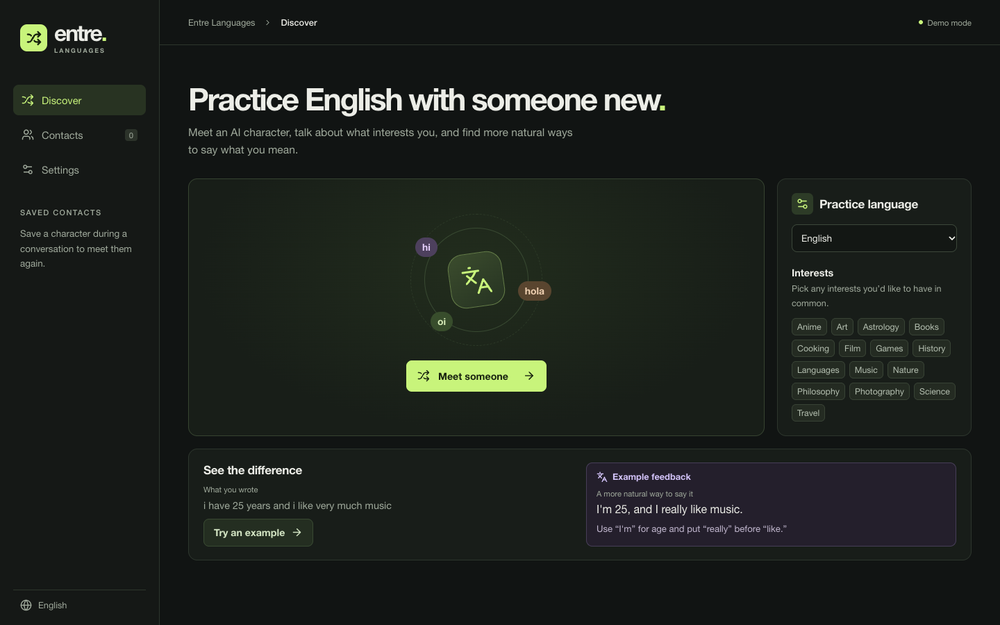
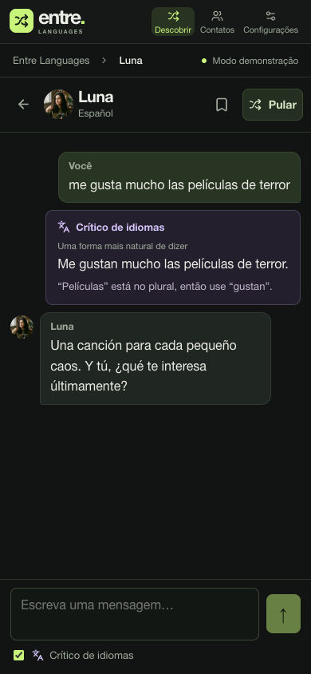
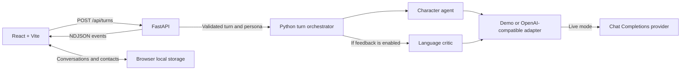
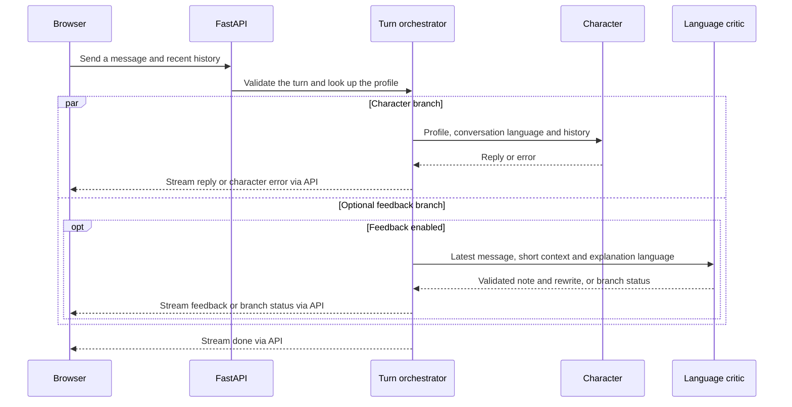

# Entre Languages

[Leia em português](README.pt-BR.md)

Practice English, Brazilian Portuguese, Spanish, or Mandarin Chinese (Simplified) through chance encounters with fictional AI characters. Choose a language, meet someone with a shared interest, and send the first message. A language critic adds a short explanation and a more natural way to say what you wrote.

**Author** · Dangeles Lima

## Try it

**Demo mode** needs no key. On the discovery screen, select a language and click **Try an example**. Send the prefilled message to see a scripted character reply and one sample critique. Each practice language has its own sample. Set the explanation language independently in **Settings**.





### Run locally

Requirements · Python 3.11+, [uv](https://docs.astral.sh/uv/), and Node.js 22.12+ on Node 22 or Node 24.

```sh
uv sync --locked
npm --prefix frontend ci
cp .env.example .env
```

Start the API and Vite in separate terminals from the repo root.

```sh
uv run --locked uvicorn entre_languages.api:app --app-dir backend --reload
```

```sh
npm --prefix frontend run dev
```

Open **http://localhost:5173**. FastAPI serves its interactive API docs at **http://127.0.0.1:8000/docs**.

To switch providers, replace the URL, API key, and model in the root `.env`, then restart FastAPI. If you set `ENTRE_CRITIC_MODEL`, update it as well or leave it blank to use the character model. Environment variables take precedence over `.env`. API keys stay on the backend.

### Use OpenAI

```dotenv
ENTRE_MODE=live
ENTRE_API_BASE_URL=https://api.openai.com/v1
ENTRE_API_KEY=your_openai_api_key
ENTRE_CHARACTER_MODEL=gpt-4.1-mini
ENTRE_CRITIC_MODEL=
```

[Create an OpenAI API key](https://platform.openai.com/api-keys)

### Use Google Gemini

Use a Gemini API key from Google AI Studio. Set the following in the backend's root `.env` and restart FastAPI.

```dotenv
ENTRE_MODE=live
ENTRE_API_BASE_URL=https://generativelanguage.googleapis.com/v1beta/openai/
ENTRE_API_KEY=your_gemini_api_key
ENTRE_CHARACTER_MODEL=gemini-3.8-flash
ENTRE_CRITIC_MODEL=
```

An empty `ENTRE_CRITIC_MODEL` uses the character model for feedback too. Google documents structured outputs on this endpoint. [Gemini API key](https://aistudio.google.com/apikey) · [OpenAI compatibility](https://aistudio.google.com/docs/openai)

### Optional avatars

Character portraits are static files provided by the catalog. Characters without a portrait display their initial. In this version, the configured models generate dialogue and language feedback. AI-generated avatars are an optional feature of the original Entre.

## Architecture



The UI sends a new message and a bounded history. The character receives its profile and up to six previous user–character pairs. The critic receives the message and at most four recent messages for context. Its reformulation preserves meaning, language, tone, slang, and intentional language mixing. Critiques are kept beside the source turn and excluded from future model context.

The two agents have separate Python protocols, prompts, and deadlines. They run concurrently via `asyncio`, and FastAPI streams each complete result as a line of JSON. The first branch to finish appears first. Once the reply arrives, the learner can continue while a critique is still pending. If a branch fails, the other can still finish. Retrying a failed reply reuses the original message in the UI.



Plain Python is enough for one fan-out with two independent tasks and a single response stream. LangGraph would become relevant if the product needed branching decisions across turns or resumable workflows. The adapter boundary already lets the application swap scripted demo responses for live inference.

| Path | Responsibility |
| --- | --- |
| [backend/entre_languages/domain.py](backend/entre_languages/domain.py) | Request and feedback schemas, agent protocols |
| [backend/entre_languages/orchestration.py](backend/entre_languages/orchestration.py) | Branch ordering, deadlines, cancellation |
| [backend/entre_languages/adapters/](backend/entre_languages/adapters/) | Scripted demo and OpenAI-compatible inference |
| [backend/entre_languages/api.py](backend/entre_languages/api.py) | HTTP, persona catalog, stream and concurrency cap |
| [frontend/src/](frontend/src/) | Discovery, chat, settings, local contacts and conversations |

## Verification

```sh
uv run --locked pytest
npm --prefix frontend run build
```

Backend tests cover the demo HTTP contract, early reply delivery, critique failure, stream cancellation, independent timeouts, the concurrency cap, and the live adapter's payload and schema against a mocked HTTP provider. For live quality, run the examples below with a configured model. The phrasing can vary. Evaluate each result for meaning, register, and whether the explanation names the actual improvement.

| Input | Check |
| --- | --- |
| `i have 25 years and i like very much music` | Keep the age and enthusiasm. Use “I'm 25” and a natural position for “really”. |
| `I'm kinda into old movies, tbh.` | Preserve casual register and accept natural slang. |
| `fazem dois anos que eu moro aqui e eu gosto muito daqui` | Use singular “faz” for elapsed time and keep the original claim. |
| `me gusta mucho las películas de terror` | Use “gustan”. With Portuguese selected for explanations, keep the rewrite in Spanish. |
| `我昨天去商店买了一个裤子` | Use the measure word “条” for a pair of pants. Keep the rewrite in Mandarin. |

## Deploy

```sh
docker build -t entre-languages .
docker run --rm -p 127.0.0.1:8000:8000 entre-languages
```

The container serves the compiled frontend and API on port 8000. On a container host, expose that port behind HTTPS and use `GET /api/health` for the health check. Demo mode works without secrets. For a live deployment, set provider credentials through the host's environment, put access or rate limits in front of the API, and configure provider spending limits. If using a reverse proxy, preserve streaming for `/api/turns`.

The app has no accounts. Contacts and up to 40 encounters with up to 60 turns each are stored in the browser and can be cleared in Settings. The backend receives at most 6,000 characters of history per turn. In live mode it sends relevant text to the configured provider.
