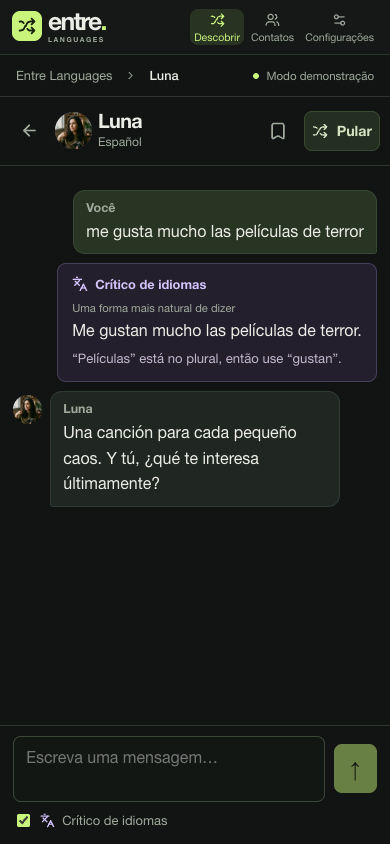
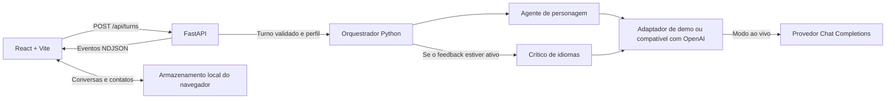
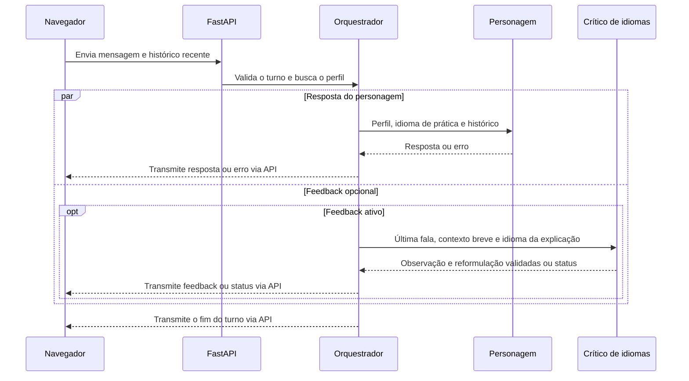

# Entre Languages

[Read in English](README.md)

Pratique inglês, português brasileiro ou espanhol em encontros aleatórios com personagens fictícios de IA. Escolha um idioma, encontre alguém com interesses em comum e mande a primeira mensagem. O crítico de idiomas acrescenta uma explicação curta e uma forma mais natural de dizer o que você escreveu.

**Autor** · Dangeles Lima

## Experimente

O **modo demonstração** funciona sem chave. Na descoberta, escolha um idioma e clique em **Testar uma frase**. Envie o texto preenchido para ver uma resposta de exemplo e a crítica correspondente. Há uma frase para cada idioma de prática. Você pode escolher o idioma das explicações em **Configurações**.



### Executar localmente

Requisitos · Python 3.11+, [uv](https://docs.astral.sh/uv/) e Node.js a partir de 22.12 na linha 22 ou Node 24.

```sh
uv sync --locked
npm --prefix frontend ci
cp .env.example .env
```

Inicie a API e o Vite em terminais separados, na raiz do projeto.

```sh
uv run --locked uvicorn entre_languages.api:app --app-dir backend --reload
```

```sh
npm --prefix frontend run dev
```

Abra **http://localhost:5173**. A documentação interativa da API fica em **http://127.0.0.1:8000/docs**.

Para gerar respostas ao vivo, defina `ENTRE_MODE=live` e `ENTRE_API_KEY` no `.env` da raiz e reinicie o FastAPI. O adaptador OpenAI usa Chat Completions e solicita um esquema JSON estrito para o crítico. Para outro endpoint compatível, configure `ENTRE_API_BASE_URL` e modelos que aceitem esse formato. `ENTRE_CRITIC_MODEL` permite escolher um modelo diferente para o crítico. Variáveis de ambiente têm prioridade sobre o `.env`. As chaves dos provedores ficam no Python. [Referência de Chat Completions](https://developers.openai.com/api/reference/resources/chat).

## Arquitetura



A interface envia a nova mensagem com um histórico limitado. O personagem recebe seu perfil e até seis pares anteriores de mensagens. O crítico recebe a última fala e até quatro mensagens recentes para interpretar o contexto. A reformulação preserva sentido, idioma, tom, gírias e alternância intencional entre idiomas. O feedback fica ao lado da mensagem original e não entra no contexto das próximas chamadas.

Os dois agentes têm protocolos Python, prompts e prazos independentes. Eles rodam em paralelo via `asyncio`, e o FastAPI transmite cada resultado completo em uma linha de JSON. A primeira resposta disponível já aparece na interface. Assim que o personagem responde, o usuário pode continuar enquanto o crítico ainda trabalha. Se um agente falhar, o outro ainda pode concluir. Ao tentar novamente após uma falha do personagem, a interface reutiliza a mensagem original.



Python é suficiente para executar duas tarefas independentes e compartilhar o mesmo fluxo de eventos. LangGraph faria sentido caso o produto precisasse de decisões que atravessassem vários turnos ou de fluxos retomáveis. O adaptador já permite trocar as respostas de demonstração por inferência ao vivo.

| Caminho | Responsabilidade |
| --- | --- |
| [backend/entre_languages/domain.py](backend/entre_languages/domain.py) | Schemas de entrada e de feedback, protocolos dos agentes |
| [backend/entre_languages/orchestration.py](backend/entre_languages/orchestration.py) | Ordem de entrega, prazos e cancelamento |
| [backend/entre_languages/adapters/](backend/entre_languages/adapters/) | Demo com exemplos e inferência compatível com OpenAI |
| [backend/entre_languages/api.py](backend/entre_languages/api.py) | HTTP, catálogo, fluxo de eventos e limite de concorrência |
| [frontend/src/](frontend/src/) | Descoberta, chat, configurações, contatos e conversas locais |

## Validação

```sh
uv run --locked pytest
npm --prefix frontend run build
```

Os testes do backend cobrem o contrato HTTP da demo, a entrega antecipada da resposta, falhas do crítico, cancelamento do fluxo, prazos independentes, limite de concorrência e o formato das chamadas ao adaptador ao vivo com um provedor HTTP simulado. Para avaliar a qualidade do modelo configurado, envie as frases abaixo no modo ao vivo. A redação pode variar. Observe se o resultado preserva sentido e registro e se a explicação aponta a melhoria feita.

| Entrada | O que observar |
| --- | --- |
| `i have 25 years and i like very much music` | Preserva a idade e o entusiasmo, usa “I'm 25” e coloca “really” numa posição natural. |
| `I'm kinda into old movies, tbh.` | Preserva o tom casual e aceita as gírias naturais. |
| `fazem dois anos que eu moro aqui e eu gosto muito daqui` | Usa “faz” no singular para indicar tempo decorrido e mantém a afirmação original. |
| `me gusta mucho las películas de terror` | Usa “gustan”. Se a explicação estiver em português, mantém a reformulação em espanhol. |

## Publicação

```sh
docker build -t entre-languages .
docker run --rm -p 127.0.0.1:8000:8000 entre-languages
```

O contêiner serve a interface compilada e a API na porta 8000. Em uma hospedagem de contêineres, exponha a porta via HTTPS e use `GET /api/health` para a checagem de saúde. A demo funciona sem segredos. Para publicar em modo ao vivo, configure as credenciais como variáveis do ambiente, aplique controle de acesso ou limite de requisições na entrada e configure um limite de gastos no provedor. Se houver proxy reverso, preserve o streaming em `/api/turns`.

A aplicação funciona sem contas. Contatos e até 40 encontros com até 60 turnos cada ficam no navegador e podem ser apagados em Configurações. O backend recebe até 6.000 caracteres de histórico por turno. Em modo ao vivo, envia o texto relevante ao provedor configurado.
